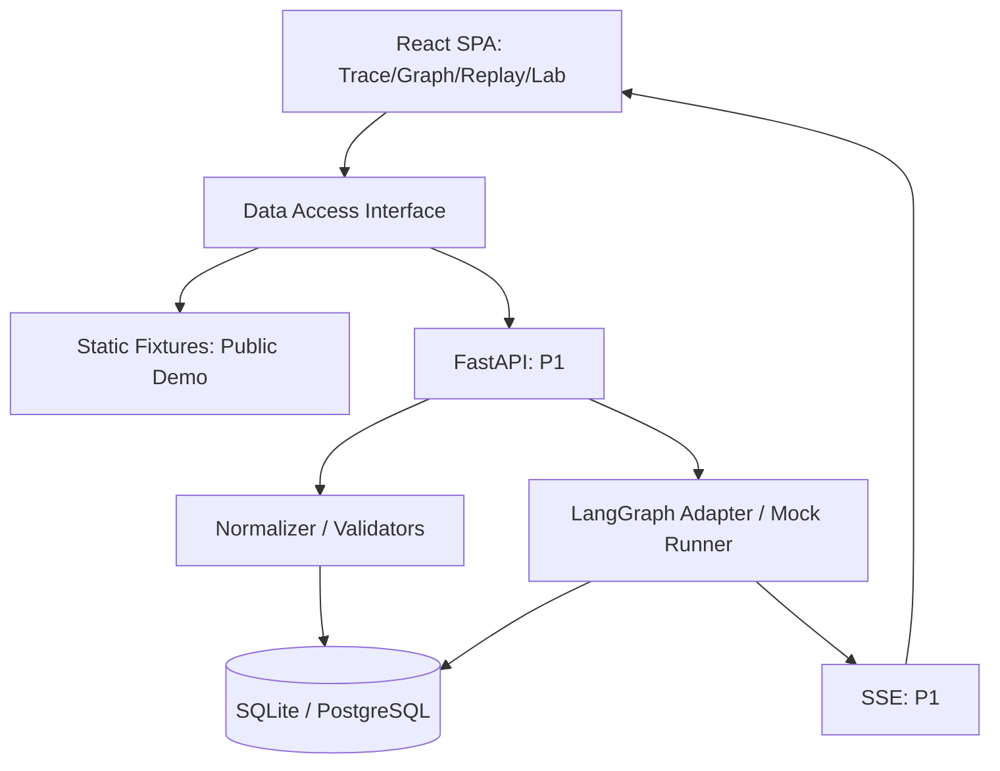
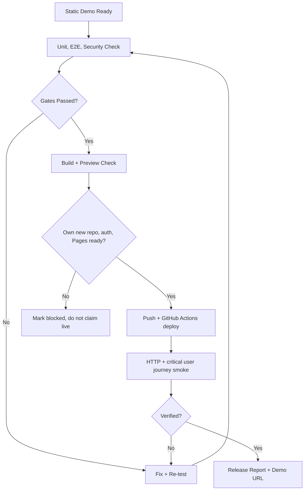

# AgentScope 从零到上线：Codex 长时间自主开发计划书

> 版本：v1.0 | 创建日期：2026-10-17  
> 实验性质：个人作品集工程 / 长时间自主开发实验  
> 输入依据：`references/Codex开发流程规范.md`（用户提供的 17 章软件开发工作流）  
> 执行方式：**一次性设定目标和权限 → Codex 按里程碑自主循环 → 自动验证和记录 → 能安全执行则发布；有不可跨越的外部门禁则如实阻塞。**

---

## 0. 这次实验究竟验证什么

不是测试“AI 是否能在几小时内生成尽可能多的代码”，而是验证 **Codex 能否在数小时内独立持续推进真实软件工程生命周期**：调研、需求、设计、实现、测试、Review、修复、安全检查、预览、部署、线上复测。

**重要事实与边界：**

- “不中断”指**不在正常里程碑之间等待用户回复**，不是保证单一进程永不退出。Codex 可能因上下文、额度、终端关闭、网络、系统休眠、权限或平台超时而停止。
- 使用 CLI 的 `codex exec` 非交互模式、持久状态文件、`codex exec resume --last` 和有界续跑脚本，**尽可能实现几小时不需要人工操作**；续跑是新一轮执行，不声称是同一个 OS 进程始终存活。
- **自动推进不意味着关闭安全隔离。** 正常开发默认 workspace-write；不启用 `--yolo`、`danger-full-access` 或无界全盘操作。
- 本计划将“上线”拆成两个严格不同的目标：**公开静态 Demo 真正上线**（可在 GitHub Pages 托管，不需要 API Key）；**完整后端公网服务上线**（只有已授权托管账号、密钥、预算、域名和保护机制时才能执行）。
- 如果无法满足远程发布条件，Codex 必须完成可本地运行的应用和可复现部署材料，标记 `blocked`，不得虚构线上 URL 或称已发布。
- **建议第一次连续运行 4–8 小时，设置 6 小时时间预算**。全量多阶段项目的开发、验证和维护通常需要多轮运行，并不保证一晚上全部完成。

## 1. 与原始 17 章规范的关系

这是一份**执行方式补充与针对 AgentScope 的具体化计划**，不是抛弃原规范。

| 原规范环节 | 继承的规则 | 自主执行的调整 |
|---|---|---|
| 1 生命周期与总体原则 | 先需求、后实现；结果必须验证 | 各阶段自动过门禁而非逐阶段等待人工 |
| 2 环境与初始化 | Git、CLI、依赖检查 | 由预检脚本识别环境，缺重要授权则阻塞 |
| 3 AGENTS.md | 固定行为规则和权限 | 明确允许/禁止操作、工作预算和状态机 |
| 4 PRD | 明确用户、范围、验收 | 使用本计划预先确认的产品目标，细化 PRD 后立即推进 |
| 5 架构与 ADR | 比较方案，保持简单 | 按预选技术栈实施，重大偏差记录 ADR |
| 6 垂直切片 | 优先贯通端到端数据流 | 先录制 Trace → 展示流程图 → 回放 |
| 7 功能与视觉验收 | 实际构建与页面检查 | 自动截图、视觉审计和 E2E，无人确认时按量化规则 |
| 8 偏差审计 | 及时纠正方向 | 每两阶段小审计、发布前独立审计 |
| 9 Bug 修复 | 复现 → 测试 → 最小修复 | 限制修复次数，禁止为绿灯删测试 |
| 10 安全审计 | OWASP、密钥、上传、日志 | 严重风险可自动修复；未消除高危不得发布 |
| 11 Git/CI | 小提交、CI、PR 理念 | 独立新仓库允许自动里程碑提交；发布需要 CI |
| 12 部署 | Preview → 生产 → 线上验证 | 公共静态 Demo 可预授权部署；生产后端有独立门禁 |
| 13 维护 | 错误、回归、变更记录 | 生成维护手册，自动执行有限的发布后冒烟检查 |
| 14 项目目录 | 文档、源码、测试分层 | 按 Python API + TypeScript Web Monorepo 调整 |
| 15 时间安排 | 里程碑与 DoD | 使用时间预算和实际进展，不按钟点强制跳过质量 |
| 16 启动提示词 | 单一清晰任务说明 | 改为持续推进的总控提示词，见 `CODEX_MASTER_PROMPT.md` |
| 17 完成定义 | 代码、测试、文档、风险透明 | 机器可查进度状态 + 最终报告 + 真实线上 URL |

### 一次性授权范围（在开始运行前已由用户选择本实验方案）

默认授权 **仅限本项目专用工作目录、专用新 GitHub 仓库和不含敏感数据的公开演示站**：

- 允许安装开源依赖、生成修改删除本项目工作区内的文件、运行本地开发服务、测试、容器和浏览器测试。
- 允许对本项目进行 Git 初始化、建立分支和本地里程碑提交；如 `gh auth` 已就绪，可在用户账号下创建**专用新公开仓库**并推送该项目（不得修改已有项目或个人主页仓库）。
- 允许在该**专用新仓库**配置 GitHub Actions、发布公开静态 Demo（如 Pages 的必要权限已经可用）；确保上线后独立 HTTP 冒烟测试。
- 不允许读取、修改或删除其他仓库、文件夹、现存生产数据、个人资料；不允许付费、购买域名、删除云资源、扩大云 IAM 权限。
- 不允许生成新密钥、绕过登录/2FA、关闭 GitHub 安全规则、修改组织设置、提交或回显凭据。
- 如果平台要求确认 GitHub Pages Source、授予权限或云服务账号登录，必须记录为人工阻塞，不得通过关闭安全机制“解决”。
- 生产环境的新增**可收费资源**、真实用户账号与数据、不可逆数据库变更，均未在本方案中授权。

## 2. 产品定义（Codex 必须据此生成 `docs/PRD.md`）

### 2.1 定位

**AgentScope（暂定代号，公开前核查同名项目并选定易区分的正式名称）**

> 可视化检查 AI Agent 的真实执行链路；定位失败原因；按原始事件回放；在隔离的实验中注入工具故障，并比较修复策略。

> English: An open-source debugging workbench for visualizing agent traces, replaying recorded events, and comparing controlled failure-recovery experiments.

竞品参考：Langfuse、LangSmith Studio、Arize Phoenix、Comet Opik、Agent Replay；UI 参考 React Flow。借鉴 Trace Inspector、运行图与评测流程，但**不得直接复制别人的实现或宣称这些功能首次出现**。名称 `AgentScope` 与 `agentscope-ai/agentscope` 存在潜在混淆，仓库可先使用 `agent-scope-lab` 暂名。

### 2.2 目标用户

- 学习或开发 LangGraph / LangChain / 自定义 Agent 的开发者；
- 希望复现故障、分析工具调用、比较恢复策略的工程师；
- GitHub 访客/招聘方：在 30 秒内使用**无需注册、无需 API Key** 的演示理解项目价值。

### 2.3 核心用户旅程

1. 打开公开 Live Demo，看到 3 个合成演示案例。
2. 选择“工具超时”，进入 Trace Detail。
3. 流程图清楚展示 Agent、工具调用、出错节点，右侧列出错误和耗时。
4. 移动时间轴逐事件播放，图与详情同步更新。
5. 选择一种预设恢复策略，进行确定性 **Mock** 模拟。
6. 查看基线与模拟方案差异、断言通过情况；打开相关源码与架构文档。

**记录回放 ≠ 重新运行 LLM ≠ checkpoint 重启。** 各模式的 UI 与数据标识必须准确。

### 2.4 产品范围：发布时必须具备的 P0

- [ ] 设计统一 Trace / Span / Event Schema，明确 schema_version。
- [ ] 内置 3 套合成、脱敏的演示数据：证据冲突、工具超时、非法 JSON。
- [ ] Trace Explorer：列表、搜索/筛选和状态、耗时展示。
- [ ] Trace Detail：以事件驱动的真实动态图、Span Inspector、时间线回放。
- [ ] 回放稳定：同一 Trace 的逐步状态多次播放一致；不触发真实工具副作用。
- [ ] Demo Failure Lab：至少工具超时有 2 种预设修复策略，可重复模拟并比较结果。
- [ ] JSON 导入：客户端限制大小/结构；拒绝危险内容、循环/缺失父节点等非法关系。
- [ ] 统计：真实基于当前演示集合计算的运行次数/故障率；缺失指标明确显示“未采集”。
- [ ] 自适应深色 UI，桌面优先，移动端可读，无横向失控。
- [ ] 测试和工程化：TypeScript 严格检查、格式检查、单测、E2E、CI、构建。
- [ ] 可公开访问的**静态 Demo**、双语 README、截图/GIF、架构图、安装说明、许可证。

### 2.5 面向完整后端的 P1（静态 Demo 稳定后继续）

- [ ] FastAPI + Pydantic 提供项目、Trace、Span、Event 查询和 JSON 导入 API。
- [ ] SQLAlchemy 2 + Alembic：SQLite 本地持久化，PostgreSQL 兼容测试。
- [ ] `LangGraph` Adapter 接收至少一个**真实执行**的非敏感 Agent 示例。
- [ ] Mock Scenario Runner：固定场景、超时/空响应/校验失败，确定性运行。
- [ ] 实验对比：恢复耗时、重试次数、规则断言、Span 级差异。
- [ ] Docker Compose 自托管前后端；API/DB 集成测试、故障恢复检查、文档。
- [ ] 如预先准备好合适托管服务与权限，部署**受保护的完整 API**；否则提供本地和自托管部署操作，状态不冒充“生产后端已上线”。

### 2.6 明确不做

第一轮不做账号、计费、团队 RBAC、多租户、任意代码执行、访问任何用户的真实 LLM 密钥、生产场景自动修复、跨云资源操作、大规模消息队列、自建监控平台。LLM-as-a-Judge、完整 OTLP 协议兼容和真正非确定性完整重执行留给后续版本。

## 3. 技术栈（在 ADR 中记录任何变化）

| 层 | 锁定推荐 | 选择理由 |
|---|---|---|
| 前端 | React + TypeScript strict + Vite | 工具型 SPA 简洁、适合公开静态 Demo |
| UI | Tailwind CSS + shadcn/ui + lucide-react | 组件复用、可控设计语言 |
| 路由 | React Router | 显式页面路由；Pages 部署需处理 base 与 SPA fallback |
| 流程图 | `@xyflow/react` + Dagre | 节点与连线、高亮和缩放 |
| 数据可视化 | Recharts | 统计与 A/B 对比 |
| 数据状态 | TanStack Query + Zustand | 服务器状态与本地回放状态分离 |
| 校验 | Zod（前端） / Pydantic（后端） | 不可信数据进入系统前校验 |
| 后端 | Python + FastAPI | Agent 生态集成直接，OpenAPI 文档 |
| Agent | LangGraph | 接入真实执行和故障场景 |
| 持久化 | SQLAlchemy 2 + Alembic；SQLite 本地 / PostgreSQL 部署 | 迁移能力、可恢复、便于个人开发 |
| 事件推送 | SSE（仅 P1 必要时） | 运行进度单向推送，避免过早使用 WebSocket |
| 前端测试 | Vitest + Testing Library | 逻辑/交互 |
| 后端测试 | Pytest + HTTPX | API/服务/数据迁移 |
| E2E | Playwright | 真实浏览器验收和截图 |
| 质量 | ESLint、Prettier、Ruff、mypy/pyright（择一） | 持续性静态检查 |
| CI/CD | GitHub Actions + GitHub Pages（静态 Demo） | 可复制、可公示、无需先租云服务器 |
| 本地集成 | Docker Compose | API、数据库以及启动说明 |

版本策略：使用开始时兼容的稳定发行版，保存 lockfile/锁定工具链；避免直接大量引入 `latest`。Node.js、Python 和 GitHub Actions 版本须在 README 与 CI 一致。

**为什么不是先用 Spring Boot？** 你的 Java 后端经验可在后续独立扩展中展示，但初版优先用 Python LangGraph 原生生态完成完整闭环，避免双服务制造不必要耦合。保留 Spring Boot 做未来可选模块，不应阻塞上线。

## 4. 架构原则与约束



- UI 通过统一 `TraceDataSource` 接口访问数据；静态 Demo 和 API 模式共享**相同数据结构与页面逻辑**。不得创建两个互不兼容的 Demo/App。
- `WorkflowGraph` 表示逻辑流程，`ExecutionTrace` 表示这一次运行的树/事件；循环或重试会产生多个 Span。
- `trace_id`、`span_id`、`parent_span_id`，时间、事件序号、status、input/output、错误、source_framework、schema_version 语义明确。
- 对日期采用 UTC + ISO8601；当事件时间相同，必须以 `sequence` 稳定排序。
- 原始数据、标准化数据、脱敏展示数据分层；缺 Token/成本不显示假数字。
- 导入数据一律不可信：结构校验、防 XSS、限制体积/深度/数量、避免泄密；不能执行文本中的任意命令。
- 公共 Demo 不接用户 API Key、不调用需要计费的模型；后端实验只允许预定义 Mock 工具。
- 数据模型/API 变更需要更新文档、契约测试、兼容迁移方案。

## 5. 里程碑：无需人工确认的串行执行

完成条件采用可执行验收；**任何里程碑未通过，不允许报告完成并跳到上线**。可独立提交，但不保证每项都在一次运行中完成。

| 阶段 | 交付 | 主要自动门禁 |
|---|---|---|
| M0 预检 | 环境清单、版本、Git、授权检查、原规范和状态文件 | 无法运行则登记阻塞，不修改系统全局配置 |
| M1 产品与设计 | `PRD.md`、`ARCHITECTURE.md`、`DATABASE.md`、`API.md`、`TEST-PLAN.md`、ADR、ROADMAP | 目标用户、非目标、用户路径、验收标准清楚，技术栈一致 |
| M2 工程初始化 | `apps/web`, `apps/api`, CI 骨架、锁文件、环境示例 | 安装、lint、类型检查、基本构建可执行 |
| M3 端到端垂直切片 | 一条合成 Trace → Schema 校验 → Web 执行图与节点 Inspector | 动态从数据源渲染；错误数据有可预期提示；E2E 测试 |
| M4 公开演示 MVP | 三案例、回放、筛选、导入、统计、响应式、Failure Lab 基础 | 无需 API Key；浏览器中完整用户流程通过 |
| M5 静态版安全发布 | 静态 Demo 安全审查、Playwright、GitHub Actions Pages、README、演示素材 | **尽早**发布可访问的静态 Demo；如 GitHub 权限不足明确标记阻塞 |
| M6 后端数据闭环 | FastAPI CRUD/查询、DB 迁移、JSON 导入与标准化 | API 集成测试与迁移验证；刷新和重启数据不丢失 |
| M7 Agent 与实验 | LangGraph Adapter、Mock Runner、实验对比和断言 | 不产生实际外部副作用；可重复得到相同 Mock 测试结果 |
| M8 完整工程质量 | 后端脱敏、上传限流、错误处理、Docker Compose、CI、审计；有权限时受保护的动态部署 | 单测/集成/E2E/安全检查，完整服务可本地启动；公网后端以授权为前提 |
| M9 发布报告与维护 | `CHANGELOG.md`、版本说明、健康检查、回滚与风险列表 | `release-report.md` 和 `AUTONOMOUS_STATE.json` 与现实一致 |

**自动审计频率：** M3、M4、M5、M8 后做一次方向与安全审计；每个实现里程碑都有单测+差异审查。不得把“页面看上去不错”作为唯一完成标准。

### M3 垂直切片验收脚本的业务语义

1. 加载 `/fixtures/tool-timeout.json`，校验 ID、序号、父子关系、时间、异常结构。
2. 浏览器打开 Trace Detail，图中 `SearchTool` Span 标记为 `error`。
3. 点击 Span，Inspector 展示实际 JSON 的错误类型和说明。
4. 回放进度条移动到失败事件，高亮对应节点。
5. 非法 JSON 给出准确错误，不影响其他 Trace。
6. 单元测试、浏览器测试都真实运行，保存日志与截图。

### M4 公开演示功能验收（M5 验证并发布）

- **页面**：`/`、`/traces`、`/traces/:id`、`/lab`、`/experiments/:id`、`/docs`。
- **用例**：进入“Tool Timeout”→ 查失败 Span → 回放 → 选择预设重试 → 比较恢复结果。
- **视觉**：深色为主，信息层级清晰；加载、空列表、错误和长日志表现正常；截图留存。
- **路由**：在 GitHub Pages 的项目路径下能刷新、深链到 Trace（必要时采用 HashRouter）。
- **可达**：Pages 线上路径真实返回页面，资源路径不会 404；公共静态 Demo 可以离线数据运行。

## 6. 数据模型与 API 合同

`docs/DATABASE.md`、`docs/API.md` 由 Codex 在 M1 完成，下列是必须遵守的最低约束。

| 表/对象 | 最低字段 |
|---|---|
| Project | `id`, `name`, `created_at` |
| Trace | `id`, `project_id`, `source_framework`, `status`, `started_at`, `ended_at`, `schema_version` |
| Span | `id`, `trace_id`, `parent_span_id`, `type`, `name`, `status`, `started_at`, `ended_at`, `attributes`, `error` |
| TraceEvent | `id`, `trace_id`, `span_id`, `sequence`, `occurred_at`, `type`, `payload` |
| Experiment | `id`, `source_trace_id`, `scenario_id`, `strategy`, `status`, `result` |
| Evaluation | `id`, `experiment_id`, `name`, `passed`, `details` |

示例 API：

```text
GET  /api/v1/health
GET  /api/v1/projects
GET  /api/v1/traces?status=error&cursor=...
GET  /api/v1/traces/{id}
GET  /api/v1/traces/{id}/spans
GET  /api/v1/traces/{id}/events
POST /api/v1/traces/import
GET  /api/v1/scenarios
POST /api/v1/experiments
POST /api/v1/experiments/{id}/run
GET  /api/v1/experiments/{id}
```

API 类型应从 OpenAPI 生成 TS 类型或做契约一致性测试；不得手工维护互相矛盾的字段名称。

## 7. 目录与交付物

```text
agent-scope-lab/
├─ AGENTS.md                        # 执行规范和权限
├─ CODEX_MASTER_PROMPT.md            # 一次性总控提示词
├─ RUN_AGENT_SCOPE.ps1               # 受限长跑 / 续跑辅助脚本
├─ docs/
│  ├─ PRD.md / ARCHITECTURE.md / DATABASE.md / API.md
│  ├─ TEST-PLAN.md / SECURITY-REVIEW.md / DEPLOYMENT.md
│  ├─ ROADMAP.md / AUTONOMOUS_STATE.json / release-report.md
│  ├─ decisions/
│  └─ screenshots/
├─ apps/
│  ├─ web/                           # SPA
│  └─ api/                           # FastAPI
├─ packages/                         # 可选共享数据结构或 mock 引擎
├─ fixtures/                         # 合成演示数据
├─ tests/                            # E2E / 契约
├─ infra/                            # Docker Compose 与发布配置
├─ .github/workflows/                # CI, Pages
├─ README.md / README.zh-CN.md
├─ CHANGELOG.md
└─ .env.example                      # 仅样例！绝不提交真实 env
```

源码目录可随项目实际需要调整，强制的是模块边界、文档和可验证性，而非逐字符匹配目录。

## 8. 自主执行状态机与日志

Codex 必须创建并更新 `docs/AUTONOMOUS_STATE.json`，建议采用：

```json
{
  "schema_version": 1,
  "project": "agent-scope-lab",
  "phase": "M3",
  "overall_status": "in_progress",
  "last_completed_milestone": "M2",
  "public_demo_url": null,
  "verified_demo_url": null,
  "quality_gates_passed": false,
  "blockers": [],
  "next_action": "Complete Trace Detail vertical slice",
  "updated_at": "2026-10-17T00:00:00Z"
}
```

合法 `overall_status`：`in_progress` / `blocked` / `completed`；只有经验证的公开 Demo URL 和通过的质量门禁才能标 `completed`。阶段状态只代表实际交付，不得提前填充。

同步维护：

- `docs/WORKLOG.md`：逐阶段追加时间、任务、修改文件、命令、结果与风险。
- `docs/BLOCKERS.md`：阻塞项、复现、环境依赖、需要谁处理、可继续的其他任务。
- `docs/release-report.md`：最终上线 URL、版本、提交 SHA、CI run、执行过的测试、已知风险。
- `.codex-run/`：CLI 原始 JSONL 日志和最终消息；加入 `.gitignore`，不得提交带敏感内容的运行日志。

### 无人监督的决策准则

1. 遇到范围内的技术细节分歧 → 选最简单可测试方案，写 ADR，不停下来等回复。
2. 测试失败 → 复现 → 记录 → 编写/修复回归测试 → 最小修复 → 重新验证，单故障最多 3 轮独立尝试。
3. 依赖失效 → 同小版本修复或替代兼容依赖，检查 lockfile；避免盲目升级全仓库。
4. UI 效果不佳 → 浏览器截图审查 → 修正 3 个最突出问题 → 回归测试，不无休止改样式。
5. 一个阶段受外部服务限制 → 先完成不依赖外部权限的任务，然后记录可操作阻塞。
6. 遇到权限、登录、计费、凭据、真实用户数据或删除已有数据 → 绝不绕过；无其他安全任务时停止并写报告。
7. 超过本次运行预算 → 安全保存工作，写下一步，正常退出；可以以后续跑，不为了凑时长空循环。
8. 每完成可用的垂直切片 → 整理变更，运行检查，提交本地 Git，更新状态和工作日志。

### 进度证据与防止虚假完成

- 真正执行的命令及退出码；构建产物存在、E2E 截图、测试报告与访问地址。
- CI 未运行不能写 CI Pass；网页未经线上加载不能写 Deploy Verified。
- 不能通过禁用 lint、删除失败测试、静音错误、硬编码指标或替换为静态界面来“通过”。
- 关键 PRD 需求必须映射到测试用例，形成 `docs/TEST-PLAN.md` 追踪表。

## 9. Git 工作流和自动发布策略

- 默认使用独立新项目仓库，**不得修改 `MountCoder-merry` 账户其他仓库**。已经存在同名仓库时，先只读检查是否属于本项目；不确定就阻塞。
- 允许本地分支 `feat/*` 和小提交；有权限时推送到项目专属远端，要求至少一次 GitHub Actions 成功。
- 尽量通过 PR/CI 规范进行发布；无权限配置保护规则时，不假装已启用保护，必须记录当前限制。
- 在本计划预授权范围内，可以**仅为公开静态 Demo** 在项目新仓库配置 GitHub Pages 的 Actions 发布，允许部署动作执行；线上 URL 验证成功才叫上线。
- 如果无法创建仓库或启用 Pages，生成 `.github/workflows/pages.yml`、`docs/DEPLOYMENT.md`、构建结果和阻塞详情；**不得绕过权限直接提交到现有个人主页或其它仓库**。
- 前端 GitHub Pages 常见访问路径：`https://<username>.github.io/<repo>/`；不得把模板路径写成已验证的网址。

### 线上发布顺序



GitHub 官方 Pages workflow 需要 Pages 发布源启用为 `GitHub Actions`，使用 `configure-pages`、`upload-pages-artifact`、`deploy-pages` 并具备恰当的 Pages / ID token 权限。不要把后台 FastAPI 以为能直接托管在 GitHub Pages。

## 10. 安全审计与成本上限

**强制 Gate：**

- 不允许 `eval` 执行导入字段、不允许渲染危险 HTML、不允许任意命令/网络请求作为 Trace 工具运行。
- 不允许真实 API Key、JWT、数据库密码、简历或真实用户日志进入公开仓库/页面。
- 不允许存储/打印敏感调用参数未经脱敏的结果。
- 公网只有静态合成数据和纯浏览器 Mock，禁止免费公开无限制 LLM 调用端点。
- 无云服务预算额度或密钥就不申请云资源；不自动启用任何可收费产品。
- 对 P1 服务实施严格 CORS、请求大小限制、超时、错误码和日志脱敏。
- 禁止在用户真实系统上执行破坏性文件操作（大规模删除、清空、格式化、修改防火墙/注册表等）。
- 供应链检查、许可证检查、测试报告至少留档一次；关键漏洞未解决不得自动发布。

**成本策略：** 首轮公开 Demo 以不需要 LLM API、零付费托管为目标；不能保证 GitHub Actions、Codex 运行或第三方平台所有资源完全没有额度与费用限制，以实际账户政策为准。不要购买服务来解决阻塞。

## 11. 实际推荐执行方法（Windows PowerShell）

> 初始文件均在本套件里。先确保 Node.js、Python、Git、Codex CLI、GitHub CLI 已安装。**执行前必须认真检查 `AGENTS.md` 与总控提示词里的授权范围。**

**A. 用户只需做一次的环境准备**

```powershell
# 在你自己的机器上执行，示例项目目录
New-Item -ItemType Directory -Force D:\ai-coding-projects\agent-scope-lab
Set-Location D:\ai-coding-projects\agent-scope-lab
# 从下载的项目套件中复制 AGENTS.md、CODEX_MASTER_PROMPT.md、RUN_AGENT_SCOPE.ps1 和本计划书
# 如已有源码/同名项目，请先检查，勿覆盖

git init -b main
codex --version
gh auth status
```

`gh auth status` 如果未登录，可**一次性**执行 `gh auth login` 完成 GitHub 登录；Code Runner 无法自动完成你必须亲自进行的授权。

**B. 不使用续跑器的单次长任务（建议先试验）**

```powershell
Get-Content -Raw -Encoding UTF8 .\CODEX_MASTER_PROMPT.md |
  codex exec --approve-for-me --json - |
  Tee-Object -FilePath .\codex-session.jsonl
```

`--approve-for-me` 是当前 Codex CLI 提供的**自动审批审查 + workspace-write sandbox** 模式；具体 CLI 版本支持请先以 `codex exec --help` 核对。它不等于赋予所需的一切 GitHub 或部署权限。请在项目隔离目录中使用，**不要使用 `--yolo`**。

**C. 更符合“连续几个小时自主推进”的有界续跑器**

```powershell
.\RUN_AGENT_SCOPE.ps1 -MaxHours 6 -MaxTurns 12
```

脚本维护 `.codex-run` 日志，第一次执行 `codex exec`，后续在前次退出而任务未完成时尝试 `codex exec resume --last`。**不是无限重启**：受总时长/轮次/连续无进展次数/阻塞状态限制。此脚本无法拯救电脑睡眠、断电、配额和外部授权问题。

**D. 手动停止或继续**

```powershell
# 让运行器在下一轮检查时停止（不会强杀当前 Codex）
New-Item .\.codex-run\STOP -ItemType File -Force
# 恢复：删除 STOP 后再次执行运行器；或直接
codex exec resume --last "读取 docs/AUTONOMOUS_STATE.json，继续未完成里程碑，保持既定安全边界。"
```

**重要：** 本计划书和脚本是给你在自己的 Windows 电脑上执行的；交付这些文件**不代表我已在你的本机启动 Codex、创建 GitHub 仓库或部署项目**。

## 12. 计划时间与中止条件

| 时间点（预计） | 理想结果 | 不是承诺 |
|---|---|---|
| 前 30–60 分钟 | 环境预检、PRD、ARCH、里程碑和项目骨架 | 可能因安装或认证较久 |
| 1–2 小时 | 第一条 Trace 垂直切片 | 依赖和 API 设计需要实际验证 |
| 2–4 小时 | 执行图、节点详情、基本录制回放 | UI 质量需截图和 E2E |
| 4–6 小时 | 静态 Demo 完善、安全审查、尝试 Pages 发布；如成功则线上验证 | 不保证发布权限或一次完成全部功能 |
| 6–8 小时及后续 | 继续 P1 API、LangGraph、数据持久化与自托管 | 生产后端需额外运行与授权 |

中止条件：达到预算上限；无待办任务；需要新费用/外部授权；重要安全漏洞无法消除；CI 无法通过且 3 次修复尝试仍失败；持续无产出；平台限制；用户自行停止。

在被迫停止时，输出**当前进度、可靠证据、剩余任务、下一条可复制续跑命令**，使实验可审计、可复现。

## 13. Definition of Done（完工门禁）

**MVP 静态公开 Demo：**

- [ ] 三组数据都可体验，数据来源明确为合成。
- [ ] Trace 列表 → 图 → Inspector → Replay → Failure Lab → 对比完整闭环可用。
- [ ] 无真实 LLM 调用、无秘密泄漏、无未经授权的执行动作。
- [ ] `npm run lint` / typecheck / test / build 与 Playwright 实际通过（按真实脚本名执行）。
- [ ] README/README.zh-CN、架构、安装、局限、截图和 LICENSE 完整。
- [ ] 使用新仓库自动发布并通过公开 URL 独立验证，或状态明确写阻塞。

**完整应用后端：**

- [ ] API/DB/Agent/Mock 实验端到端通过集成测试，迁移、持久化、错误处理可靠。
- [ ] Docker Compose 一键部署，可从空目录复现启动；凭据只通过安全配置注入。
- [ ] 如果已经明确授权完整服务公网部署：安全审计、部署、冒烟、日志与回滚材料完整。
- [ ] 真实外部服务未完成授权时，不把后端称为“公网已上线”。

## 14. 参考链接

- 用户原规范：`references/Codex开发流程规范.md`。
- Codex CLI 官方：<https://developers.openai.com/codex/cli/reference>（`codex exec` / `--approve-for-me` / `resume --last` / `--sandbox`）。
- Codex 安全：<https://developers.openai.com/codex/security>。
- GitHub Pages：<https://docs.github.com/en/pages/getting-started-with-github-pages/configuring-a-publishing-source-for-your-github-pages-site>。
- Langfuse：<https://github.com/langfuse/langfuse>。
- Phoenix：<https://github.com/Arize-ai/phoenix>。
- Opik：<https://github.com/comet-ml/opik>。
- React Flow：<https://reactflow.dev/>。

---

**最终原则：让 Codex 连续独立完成“已经获准且可验证”的工作；不为了不中断而绕过系统权限和安全边界。**
